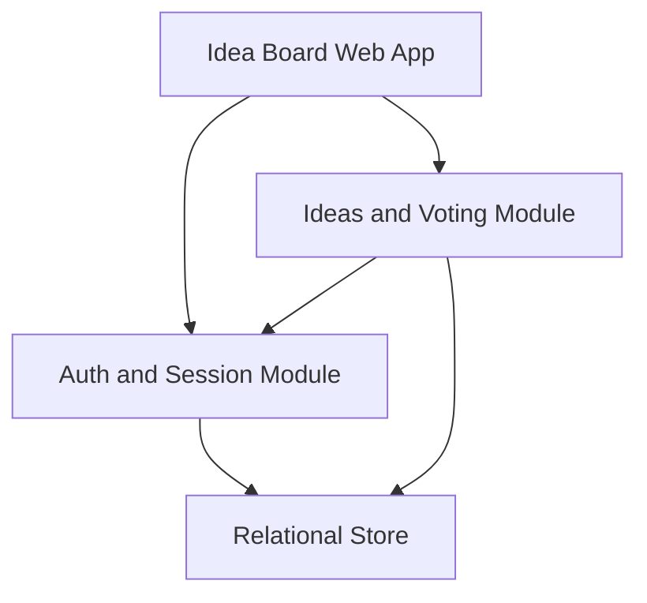
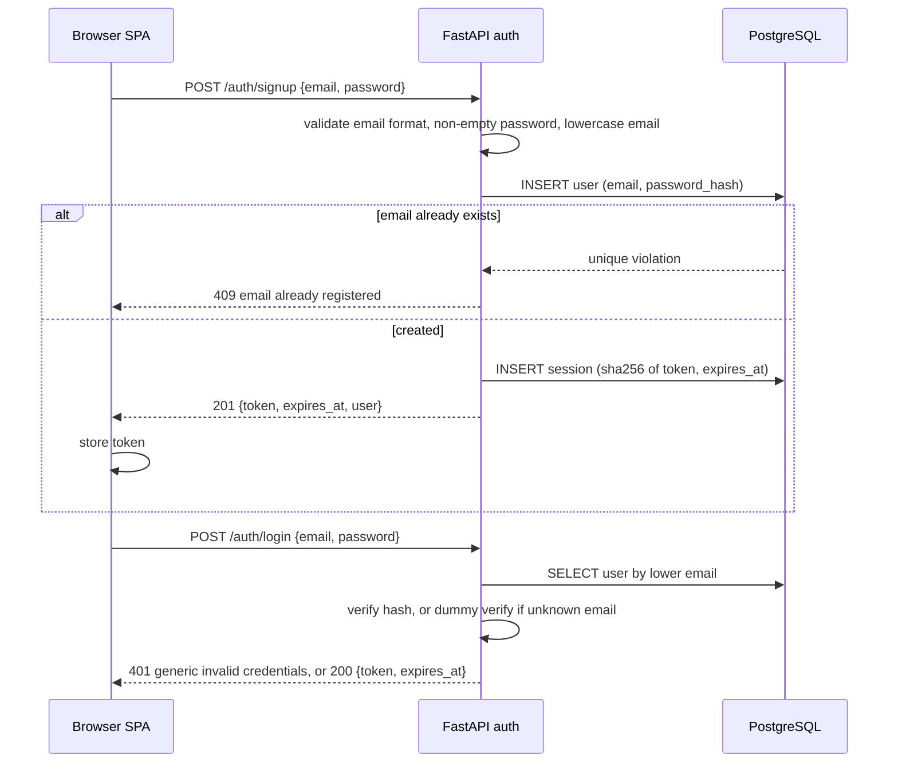
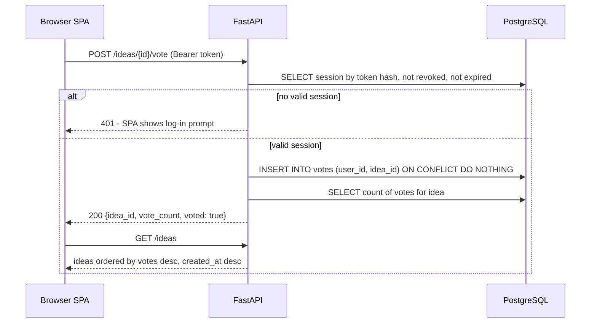
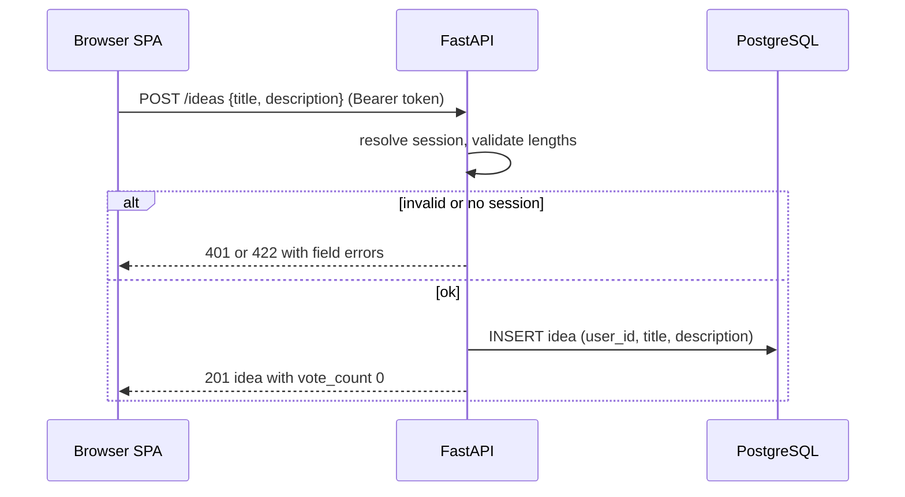
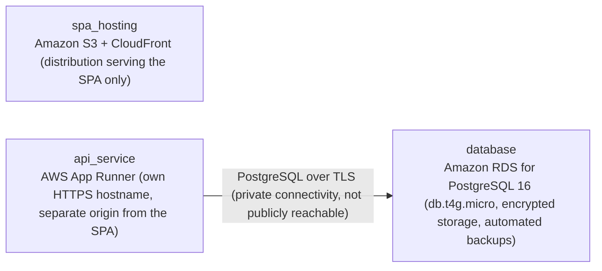

# Architecture

> Maintained by QuorQ AI SDLC. Text between `sdlc:auto` markers is regenerated; anything outside them is yours and is kept.

<!-- sdlc:auto:start narrative -->
## Overview

### ARCH-OVERVIEW · approved · source: architecture:summary

A small Idea Voting Board on the approved stack: a React 19 SPA and a FastAPI 0.115 API on two separate origins, with PostgreSQL 16 on AWS. No external services, API keys or extra infrastructure are needed.

- Version 1, status approved.
- Data: users, ideas and votes tables, plus a sessions table for sign-in.
- Sign-in: server-side sessions with an opaque token. The login response returns it in the body, and the SPA sends it as an `Authorization: Bearer` header.
- One vote per user per idea: a `UNIQUE (user_id, idea_id)` constraint in PostgreSQL. Double-clicks, retries and second tabs cannot create duplicates.
- Board: public, ranked by vote count, then newest first.
- Posting and voting are refused by the server unless the caller is logged in.

**Related:** ARCH-COMP-SPA, ARCH-COMP-AUTH, ARCH-COMP-BOARD, ARCH-COMP-DB

### ARCH-COMP-SPA · approved · source: architecture:component:spa

Idea Board Web App (React 19). It is the responsive UI for the public board and the sign-up, log-in and post-idea forms.

- Shows vote counts and each idea's 'voted' state.
- Prompts visitors to log in when they try to post or vote.
- Keeps the session token client-side.
- Sends the token as a Bearer header on every call.

**Related:** ARCH-COMP-AUTH, ARCH-COMP-BOARD, ARCH-DEP-SPA

### ARCH-COMP-AUTH · approved · source: architecture:component:api_auth

Auth and Session Module (FastAPI 0.115). It handles sign-up, log-in, log-out and current-user lookup.

- Hashes passwords with a salted hash.
- Issues opaque session tokens, stored only as a hash, with expiry and revocation.
- Exposes a dependency that resolves the Bearer token to a user, or rejects it with 401.

**Related:** ARCH-API, ARCH-DATA, ARCH-PATH-AUTH

### ARCH-COMP-BOARD · approved · source: architecture:component:api_board

Ideas and Voting Module (FastAPI 0.115). It provides the public ranked listing, idea creation and idempotent upvoting.

- Listing order: votes descending, then created_at descending.
- Idea creation includes length validation.
- Upvoting is idempotent.
- A valid session is required to post or vote.
- Author emails are never exposed.

**Related:** ARCH-API, ARCH-PATH-VOTE, ARCH-PATH-POST

### ARCH-COMP-DB · approved · source: architecture:component:db

Relational Store (PostgreSQL 16). It permanently stores users, sessions, ideas and votes.

- Enforces a case-insensitive unique email.
- Enforces the unique (user, idea) vote rule.

**Related:** ARCH-DATA, ARCH-DEP-DB

### ARCH-PATH-AUTH · approved · source: architecture:critical_path:sign-up-and-log-in

Sign up and log in with a server-side session. The visitor receives an opaque session token in the response body, which the SPA stores and sends as a Bearer header.

- A visitor signs up or logs in and receives an opaque session token in the response body.
- The SPA stores the token and sends it as a Bearer header.
- Passwords are stored as salted hashes.
- Login failures return one generic message for both an unknown email and a wrong password.

**Related:** ARCH-COMP-AUTH, ARCH-COMP-SPA

### ARCH-PATH-VOTE · approved · source: architecture:critical_path:upvote

Upvote an idea, with one vote per user per idea. The server resolves the session, then inserts the vote against the unique constraint.

- A logged-in user upvotes an idea.
- The server resolves the session, then inserts the vote with `ON CONFLICT DO NOTHING` against `UNIQUE (user_id, idea_id)`.
- A repeat request changes nothing and returns the current count with voted=true.
- A visitor gets 401, and the SPA shows the log-in prompt.

**Related:** ARCH-COMP-BOARD, ARCH-DATA

### ARCH-PATH-POST · approved · source: architecture:critical_path:post-an-idea

Post an idea. A logged-in user submits a title and short description, and the server validates and stores them.

- The server validates that both fields are non-empty and within maximum lengths: title 120, description 500.
- It stores the idea and returns it with zero votes.
- Without a valid session it returns 401.

**Related:** ARCH-COMP-BOARD

### ARCH-DATA · approved · source: architecture:entities

The data model has four tables: users, sessions, ideas and votes.

- users: id, email, password_hash, created_at
- sessions: id, user_id, token_hash, created_at, expires_at, revoked_at
- ideas: id, user_id, title, description, created_at
- votes: id, user_id, idea_id, created_at
- Constraints stated elsewhere in the input:
  - Email is unique, ignoring case.
  - `UNIQUE (user_id, idea_id)` on votes.

**Related:** ARCH-COMP-DB

### ARCH-API · approved · source: architecture:endpoints

The API has eight endpoints covering auth, the ideas board and a health check.

- POST /auth/signup: creates an account and logs in immediately. Rejects an invalid email, an empty password, and a duplicate email ignoring case (409). Any email domain is accepted.
- POST /auth/login: logs in with email and password. Returns the same generic 401 for an unknown email and a wrong password.
- POST /auth/logout: revokes the current session token on the server immediately.
- GET /auth/me: returns the current user. The SPA uses it to show the logged-in state and to detect an expired session.
- GET /ideas: public board, ordered by vote count descending, ties newest first. Includes voted=true per idea when a valid token is sent. Never includes author emails.
- POST /ideas: posts an idea with zero votes. Title is required, max 120 characters. Description is required, max 500 characters.
- POST /ideas/{idea_id}/vote: upvotes an idea. Idempotent, so a repeat vote by the same user changes nothing. Own ideas may be voted on. No un-vote or downvote endpoint exists.
- GET /health: liveness and database connectivity check for the hosting platform.

**Related:** ARCH-COMP-AUTH, ARCH-COMP-BOARD

### ARCH-DEP-SPA · approved · source: architecture:deployment:spa_hosting

The SPA is hosted on Amazon S3 with a CloudFront distribution that serves the SPA only.

- Static React 19 build.
- `VITE_API_BASE_URL` is set at build time to the API origin.

**Related:** ARCH-COMP-SPA, ARCH-DEP-API

### ARCH-DEP-API · approved · source: architecture:deployment:api_service

The API runs on AWS App Runner as a Docker container, on its own HTTPS hostname.

- Container: Python with FastAPI 0.115 under uvicorn.
- The hostname is a separate origin from the SPA.

**Related:** ARCH-COMP-AUTH, ARCH-COMP-BOARD, ARCH-DEP-SPA, ARCH-DEP-DB

### ARCH-DEP-DB · approved · source: architecture:deployment:database

The database runs on Amazon RDS for PostgreSQL 16.

- Instance class: db.t4g.micro.
- Encrypted storage.
- Automated backups.

**Related:** ARCH-COMP-DB, ARCH-DEP-API

### ARCH-TECH-FE · approved · source: architecture:technology_decision:frontend

Frontend: React 19, approved by the product owner. No alternatives were recorded.

- Rationale: handles the re-ordering board, the forms and the responsive layout.
- It keeps the session token in client state to send as a Bearer header.

**Related:** ARCH-COMP-SPA

### ARCH-TECH-BE · approved · source: architecture:technology_decision:backend

Backend: FastAPI 0.115, approved by the product owner. No alternatives were recorded.

- Rationale: a small API covers sign-up, log-in, log-out, list, post and vote.
- Pydantic validation handles email format and length limits.
- Sessions are server-side opaque tokens instead of cookies.

**Related:** ARCH-COMP-AUTH, ARCH-COMP-BOARD

### ARCH-TECH-DB · approved · source: architecture:technology_decision:database

Database: PostgreSQL 16, approved by the product owner. No alternatives were recorded.

- Rationale: users, sessions, ideas and votes are plain tables.
- A `UNIQUE (user_id, idea_id)` constraint enforces one vote per user per idea, even under concurrent requests.

**Related:** ARCH-COMP-DB, ARCH-DATA

### ARCH-TECH-CLOUD · approved · source: architecture:technology_decision:cloud

Cloud: AWS, approved by the product owner. No alternatives were recorded.

- S3 and CloudFront host the SPA.
- App Runner hosts the API on its own origin.
- RDS hosts PostgreSQL.
- No other services are needed.

**Related:** ARCH-DEP-SPA, ARCH-DEP-API, ARCH-DEP-DB
<!-- sdlc:auto:end narrative -->

<!-- sdlc:auto:start building-blocks -->
## Building Block View

| ID | Name | Technology | Responsibility | Depends on |
|---|---|---|---|---|
| spa | Idea Board Web App | React 19 | Responsive UI for the public board, sign-up, log-in and post-idea forms. Shows vote counts and 'voted' state, prompts visitors to log in on post or vote, keeps the session token client-side and sends it as a Bearer header on every call. | api_auth, api_board |
| api_auth | Auth and Session Module | FastAPI 0.115 | Sign-up, log-in, log-out and current-user lookup. Hashes passwords with a salted hash, issues opaque session tokens (stored only as a hash, with expiry and revocation), and exposes a dependency that resolves the Bearer token to a user, or rejects it with 401. | db |
| api_board | Ideas and Voting Module | FastAPI 0.115 | Public ranked idea listing (votes desc, created_at desc), idea creation with length validation, and idempotent upvoting. Requires a valid session to post or vote. Never exposes author emails. | api_auth, db |
| db | Relational Store | PostgreSQL 16 | Permanent storage of users, sessions, ideas and votes. Enforces case-insensitive unique email and the unique (user, idea) vote rule. | — |

<!-- sdlc:auto:end building-blocks -->

<!-- sdlc:auto:start runtime -->
## Runtime View

### Sign up and log in with server-side session

A visitor signs up or logs in and receives an opaque session token in the response body. The SPA stores it and sends it as a Bearer header. Passwords are salted hashes, and login failures return one generic message for both unknown email and wrong password.

- **Components:** spa, api_auth, db
- **Modules:** app/routers/auth.py, app/services/security.py, app/models.py
- **Key functions:** signup(email, password) -> {token, expires_at, user}, login(email, password) -> {token, expires_at, user}, hash_password(password) -> str, verify_password(password, hash) -> bool, create_session(user_id) -> (raw_token, expires_at), get_current_user(authorization) -> User

### Upvote an idea (one vote per user per idea)

A logged-in user upvotes an idea. The server resolves the session, then inserts the vote with ON CONFLICT DO NOTHING against the UNIQUE (user_id, idea_id) constraint. A repeat request changes nothing and returns the current count with voted=true. A visitor gets 401 and the SPA shows the log-in prompt.

- **Components:** spa, api_board, api_auth, db
- **Modules:** app/routers/ideas.py, app/deps.py, app/models.py
- **Key functions:** get_current_user(authorization) -> User, upvote(idea_id, user) -> {idea_id, vote_count, voted}, list_ideas(optional_user) -> list[IdeaOut]

### Post an idea

A logged-in user submits a title and short description. The server validates non-empty and maximum lengths (title 120, description 500), stores the idea, and returns it with zero votes. Without a valid session it returns 401.

- **Components:** spa, api_board, api_auth, db
- **Modules:** app/routers/ideas.py, app/schemas.py
- **Key functions:** create_idea(payload, user) -> IdeaOut

<!-- sdlc:auto:end runtime -->

<!-- sdlc:auto:start deployment-view -->
## Deployment View

| Name | Service | Runtime | Scaling | Environment |
|---|---|---|---|---|
| spa_hosting | Amazon S3 + CloudFront (distribution serving the SPA only) | Static React 19 build, with VITE_API_BASE_URL set at build time to the API origin | Managed, no configuration | dev |
| api_service | AWS App Runner (own HTTPS hostname, separate origin from the SPA) | Docker container: Python with FastAPI 0.115 under uvicorn | Fixed at 1 small instance, low load accepted | dev |
| database | Amazon RDS for PostgreSQL 16 (db.t4g.micro, encrypted storage, automated backups) | PostgreSQL 16 | Single instance, no replicas | dev |

| Source | Target | Protocol |
|---|---|---|
| api_service | database | PostgreSQL over TLS (private connectivity, not publicly reachable) |

<!-- sdlc:auto:end deployment-view -->

<!-- sdlc:auto:start decisions -->
## Architecture Decisions

| Layer | Choice | ADR |
|---|---|---|
| Frontend | React 19 | [ADR-0001](adr/frontend.md) |
| Backend | FastAPI 0.115 | [ADR-0002](adr/backend.md) |
| Database | PostgreSQL 16 | [ADR-0003](adr/database.md) |
| Cloud | AWS | [ADR-0004](adr/cloud.md) |
<!-- sdlc:auto:end decisions -->

<!-- sdlc:auto:start links -->
## Related Documents

- [Data Model](data-model.md)
- [API Specification](api/openapi.yaml)
- [Architecture Decision Records](adr/README.md)
<!-- sdlc:auto:end links -->
