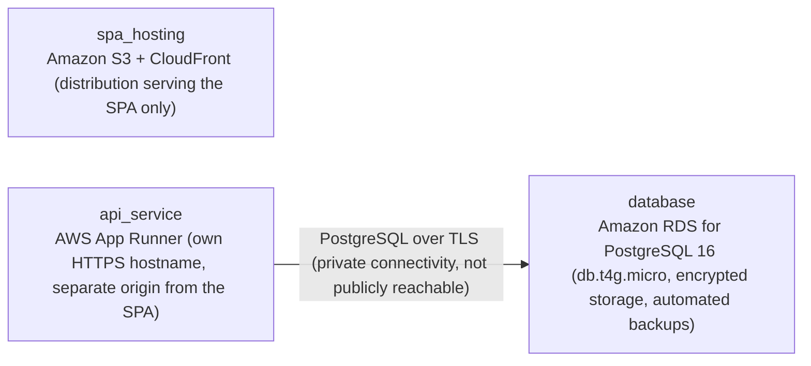

# Deployment Guide

> Maintained by QuorQ AI SDLC. Text between `sdlc:auto` markers is regenerated; anything outside them is yours and is kept.

<!-- sdlc:auto:start how-it-deploys -->
Pushes to `main` run `.github/workflows/deploy.yml`, which builds the API image (if there is a backend) and deploys the SPA to AWS Amplify. Commits touching only `docs/sdlc/**` don't deploy. Deployments can also be started from the platform's Deployment tab.
<!-- sdlc:auto:end how-it-deploys -->

<!-- sdlc:auto:start environments -->
| Name | Service | Runtime | Scaling | Environment |
|---|---|---|---|---|
| spa_hosting | Amazon S3 + CloudFront (distribution serving the SPA only) | Static React 19 build, with VITE_API_BASE_URL set at build time to the API origin | Managed, no configuration | dev |
| api_service | AWS App Runner (own HTTPS hostname, separate origin from the SPA) | Docker container: Python with FastAPI 0.115 under uvicorn | Fixed at 1 small instance, low load accepted | dev |
| database | Amazon RDS for PostgreSQL 16 (db.t4g.micro, encrypted storage, automated backups) | PostgreSQL 16 | Single instance, no replicas | dev |
<!-- sdlc:auto:end environments -->

<!-- sdlc:auto:start live -->
_Not deployed yet._
<!-- sdlc:auto:end live -->

<!-- sdlc:auto:start topology -->

<!-- sdlc:auto:end topology -->
